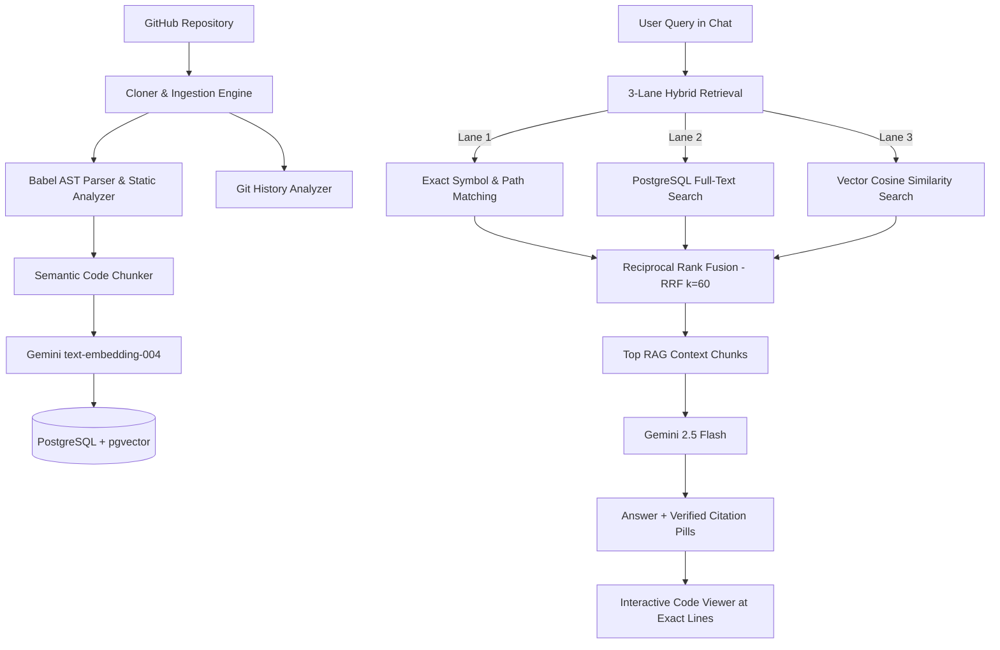

# CodeLens 🔍

> **AI-Powered GitHub Repository Intelligence & Architecture Explorer**

[](https://codelens-front.onrender.com)
[](https://www.typescriptlang.org/)
[](https://react.dev/)
[](https://nodejs.org/)
[](https://github.com/pgvector/pgvector)
[](https://ai.google.dev/)

---

### 🌐 Live Application
Explore any public or private GitHub repository live at:  
👉 **[https://codelens-front.onrender.com](https://codelens-front.onrender.com)**

---

## 📖 Overview

**CodeLens** transforms any GitHub repository into an interactive, understandable, and conversational codebase. By pairing deep static analysis and Abstract Syntax Tree (AST) parsing with state-of-the-art **Hybrid RAG (Reciprocal Rank Fusion)** and Google Gemini LLMs, CodeLens lets you navigate architectures, explore dependency flows, inspect Git history, and ask technical questions with **clickable, line-accurate code citations**.



---

## ✨ Key Features

### 🧠 Graph-Augmented Hybrid RAG (Phase 27)
CodeLens does not rely solely on semantic vector search. It implements a **three-lane Reciprocal Rank Fusion (RRF)** retrieval engine:
1. **Exact Symbol & Path Retrieval:** Zero-embedding-latency deterministic matching for function names, classes, interfaces, and file paths.
2. **PostgreSQL Keyword Search:** Native full-text search (`tsvector` / `websearch_to_tsquery`) to catch exact token occurrences.
3. **Semantic Vector Search:** 768-dimensional embeddings generated with `text-embedding-004` and indexed using PostgreSQL `pgvector` HNSW cosine indexes.
4. **Deterministic Fusion ($k=60$):** Merges all three retrieval streams into an optimal 6-chunk context window with lane weighting and multi-lane agreement boosting.

### 💬 Grounded AI Chat with Interactive Citations
- Ask anything from *"Explain the high-level architecture"* to *"What database models are defined?"*.
- Powered by **Google Gemini** (`gemini-2.5-flash`) with automatic multi-model fallback resiliency.
- Every claim in the generated answer includes **verified interactive citation pills** (`[1]`, `[2]`). Clicking any citation opens the Code Viewer and highlights the exact file and line range.

### 📜 Git History Intelligence
- Understand codebase evolution over time through natural language.
- Query recent commits: *"What changed in the last commit?"*, *"What changed between the last two commits?"*, or *"Which commits introduced authentication changes?"*.
- Intelligent intent detection routes queries between codebase RAG and commit diff analysis.

### 🗺️ Visual Architecture & Code Flow Exploration
- **System Architecture:** Auto-detects frontend layers, backend controllers, database layers, utilities, and external services.
- **Visual Code Flows:** Traces execution paths from request entry points through services to database calls.
- **APIs & Endpoints:** Catalogs and visualizes REST endpoints, HTTP methods, and route handlers.
- **Database Schema Viewer:** Discovers entities, tables, fields, types, and relational foreign keys.

### 🔍 Interactive Code Viewer
- Full directory file tree with file-type icons.
- Syntax-highlighted code inspection powered by Prism.js.
- Symbol outline drawer showing functions, classes, interfaces, imports, and exports parsed directly from the AST.

### 🛡️ Security & Quality Audit
- Scans files for exposed API keys, plaintext secrets, unsafe regexes, and vulnerable patterns.
- Reports actionable remediation guidance for each finding.

### 🔐 Multi-Tenant User Isolation & Shared Analysis Cache
- **Supabase Authentication:** Secure JWT-based registration, email verification, and session management.
- **Row-Level Security (RLS):** Individual workspaces and chat histories are strictly isolated per user.
- **Global Commit Cache:** If multiple users analyze the same repository at the same commit SHA, CodeLens reuses the cached analysis and embeddings, eliminating redundant LLM API costs.

---

## 🛠️ Technology Stack

| Layer | Technologies |
| :--- | :--- |
| **Frontend** | React 19, TypeScript, Vite, React Router 7, Prism.js, Lucide Icons, Vanilla CSS |
| **Backend** | Node.js (v20+ / v22), Express, TypeScript, Babel Parser (`@babel/parser`, `@babel/traverse`), simple-git |
| **Database & Vector Store** | PostgreSQL 15+, `pgvector` (HNSW indexing), `pgcrypto`, hosted on Supabase |
| **AI & Embeddings** | Google Gemini API (`gemini-2.5-flash`, `text-embedding-004` 768-dim) |
| **Authentication** | Supabase Auth (GoTrue, JWT, RLS policies, supported WebSocket transport) |
| **Deployment** | Render (Web Service for Backend, Static Site for Frontend) |

---

## 🚀 Getting Started Locally

### Prerequisites
- **Node.js** (v20.x or v22.x recommended)
- **npm** (v10+)
- **PostgreSQL** instance with `pgvector` enabled (or a free [Supabase](https://supabase.com) project)
- **Google Gemini API Key** ([Google AI Studio](https://aistudio.google.com/))
- **GitHub Personal Access Token** ([GitHub Settings](https://github.com/settings/tokens))

---

### 1. Clone the Repository
```bash
git clone https://github.com/SAM2330/Codelens.git
cd Codelens
```

---

### 2. Configure Backend
```bash
cd backend
npm install
```

Create a `.env` file in the `backend/` directory:
```env
PORT=5000
DATABASE_URL=postgresql://postgres:[PASSWORD]@[HOST]:5432/postgres
GEMINI_API_KEY=your_gemini_api_key_here
GITHUB_TOKEN=your_github_personal_access_token_here
SUPABASE_URL=https://[YOUR-PROJECT-REF].supabase.co
SUPABASE_ANON_KEY=your_supabase_anon_key_here
```

Build and run the backend:
```bash
npm run build
npm start
```
*The database schema will automatically initialize and synchronize on the first run.*

---

### 3. Configure Frontend
Open a new terminal window:
```bash
cd frontend
npm install
```

Create a `.env` file in the `frontend/` directory:
```env
VITE_API_URL=http://localhost:5000/api
VITE_SUPABASE_URL=https://[YOUR-PROJECT-REF].supabase.co
VITE_SUPABASE_ANON_KEY=your_supabase_anon_key_here
```

Start the Vite development server:
```bash
npm run dev
```
Open **[http://localhost:3000](http://localhost:3000)** in your browser.

---

## 📂 Repository Structure

```
codelens/
├── backend/
│   ├── src/
│   │   ├── controllers/         # Express route handlers
│   │   ├── db/                  # PostgreSQL pool, DDL schema, migrations
│   │   │   ├── repositories/    # Database query layer (repositoryDb.ts)
│   │   │   ├── init.ts          # Schema initialization & table verification
│   │   │   └── schema.sql       # PostgreSQL DDL with pgvector & RLS
│   │   ├── middleware/          # Supabase auth & repository access checks
│   │   ├── routes/              # API route definitions
│   │   ├── services/            # Core business logic:
│   │   │   ├── astAnalyzer.ts           # Resilient Babel AST symbol parsing
│   │   │   ├── codeChunker.ts           # Syntax-aware semantic chunking
│   │   │   ├── embeddingService.ts      # Gemini text-embedding-004 generation
│   │   │   ├── exactSearchService.ts    # Exact symbol & file-path retrieval
│   │   │   ├── gitHistoryService.ts     # Git commit intelligence & routing
│   │   │   ├── llmService.ts            # Grounded Gemini chat & citation validator
│   │   │   ├── ragService.ts            # 3-lane Hybrid RAG orchestrator
│   │   │   ├── rrfService.ts            # Reciprocal Rank Fusion (RRF) algorithm
│   │   │   └── vectorSearchService.ts   # Cosine similarity vector search
│   │   └── server.ts            # Express server entry point
│   └── tests/                   # End-to-end integration & regression suites
└── frontend/
    ├── src/
    │   ├── components/          # Reusable UI components (Layout, CitationLink, etc.)
    │   ├── context/             # AuthContext (Supabase auth & session state)
    │   ├── pages/               # Application views:
    │   │   ├── RepositoriesPage.tsx # Repository workspace dashboard
    │   │   ├── OverviewPage.tsx     # High-level repo stats & analysis
    │   │   ├── CodePage.tsx         # Interactive Code Viewer & AST tree
    │   │   ├── ChatPage.tsx         # AI Copilot with interactive citations
    │   │   ├── ArchitecturePage.tsx # Architecture layer visualizer
    │   │   ├── CodeFlowsPage.tsx    # Visual execution flow graphs
    │   │   ├── APIsPage.tsx         # REST endpoint catalog
    │   │   ├── DatabasePage.tsx     # Database schema entity visualizer
    │   │   └── SecurityPage.tsx     # Security audit findings
    │   └── services/            # API & Supabase clients
    └── vite.config.ts           # Vite bundler & development proxy config
```

---

## 🧪 Testing

The backend includes comprehensive integration and unit test suites:
```bash
cd backend

# Run backend TypeScript check
npx tsc --noEmit

# Run Phase 27.1 Exact Retrieval tests
node --import tsx tests/phase27_1_exact_retrieval.ts

# Run Phase 27.2 RRF Hybrid Retrieval tests
node --import tsx tests/phase27_2_rrf_retrieval.ts

# Run Pre-Release Blocker Verification suite
node --import tsx tests/pre_release_fixes.ts

# Run Phase 25 & 25.1 Multi-User Integration suites
node --import tsx tests/phase25_integration.ts
node --import tsx tests/phase25_1_integration.ts
```

---

## 📄 License
This project is open-source and available under the [MIT License](LICENSE).
